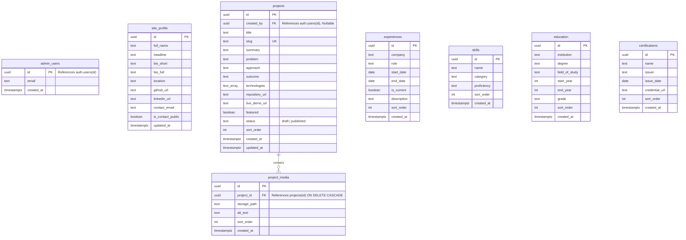

# M00 — Implementation Plan: Portfolio Architecture and Governance

> **Milestone ID:** M00-discovery  
> **Status:** ARCHITECTURE APPROVED BY CHATGPT — IMPLEMENTING M00 GOVERNANCE  
> **Date:** 2026-11-15  
> **Author:** Antigravity (Implementation Planner & Documentation Maintainer)  
> **Review Workflow:** Antigravity (Plan Author) → ChatGPT (Architecture & Acceptance Reviewer) → Project Owner (Final Authority & Approver)  
> **Operating Mode:** IMPLEMENT APPROVED M00 GOVERNANCE (Documentation and governance synchronization only; application code and infrastructure changes prohibited)

---

## Architecture Review Decision & Scope Authority

- **ChatGPT Architecture Review:** **APPROVED** (Plan v0.3).
- **Approved Technical Baseline:** Next.js 16 App Router (Active LTS), React 19, TypeScript strict mode, Tailwind CSS v4, Supabase (PostgreSQL/Auth/Storage deferred to M02), Vercel Hobby hosting, and npm package management.
- **M01 Package Revalidation Safeguard:** Prior to running package installations in M01, the implementation agent must revalidate current stable, secure package versions against official registries and security advisories, strictly avoiding canary or unpinned dependencies.
- **Project Owner Authority Retained:** The project owner retains exclusive decision authority over account creation, public repository creation, publication of personal information, cloud service provisioning, and production deployments. Approval of the architecture plan does **NOT** authorize these external or destructive actions.

---

## Document Revision History

| Version | Date | Author | Summary of Changes |
|---|---|---|---|
| v0.1 | 2026-11-15 | Antigravity | Initial discovery plan produced in chat session. Prohibited file writes per strict plan-mode gate. |
| v0.2 | 2026-11-15 | Antigravity | Persisted plan to durable on-disk artifact (`docs/milestones/M00-discovery/PLAN.md`). Corrected command exit interpretations, clarified network read operations, selected Next.js 15.2.x LTS as primary version, noted Next.js 16 `proxy.ts` convention, defined non-destructive M01 scaffolding strategy, deferred Supabase provisioning to M02, favored publishable client keys over `service_role`, corrected ERD foreign key relationships, hardened SQL functions with explicit search paths, replaced unverified performance claims with measurable targets, labeled test snippets as pseudocode, established free-tier backup/migration runbook, and marked search-derived repository claims as unverified. |
| v0.3 | 2026-11-15 | Antigravity | Updated framework baseline to Next.js 16.4.6 (Active LTS) with Next.js 16 `proxy.ts` conventions; revalidated peer dependencies and pinned exact resolved versions; documented Node 26 LTS pinning across local/CI/Vercel; refined non-destructive M01 scaffold with `--disable-git`, `--skip-install`, and diff-before-copy procedure; deferred Supabase libraries to M02; hardened database functions with `SECURITY DEFINER SET search_path = ''`, explicit grants, and revoked public/anon execution; specified table-level grants alongside RLS; detailed secure out-of-band initial admin provisioning; made CRUD test acceptance strict (requiring 404 for drafts, zero content leakage, testing actual mutation handlers and direct PostgREST, negative RLS matrix, and `/admin/login` public reachability); corrected Supabase CLI backup flags, added `.gitignore` protection for backups, clarified storage/seed limits, and distinguished local vs remote resets; added mandatory pre-publication scan across all tracked files; removed "zero client JS" guarantees; clarified INP as a user responsiveness metric requiring interactive testing. |
| v0.4 | 2026-11-15 | Antigravity | Recorded formal ChatGPT architecture review approval; documented M01 package revalidation requirement and owner authority retention over external accounts/repos/secrets; transitioned status to implementing M00 governance. |

---

## 1. Executive Summary & Objective

The objective of Milestone 00 (**M00**) is to establish the complete architectural foundation, technical governance, security posture, and verified roadmap for a personal software engineering portfolio with a production-grade, authenticated administrator CRUD dashboard.

The application must satisfy two primary goals:
1. **Academic Assessment & Verifiable CRUD:** Provide demonstrable, persistent Create, Read, Update, and Delete (CRUD) operations backed by database-level Row-Level Security (RLS) and server-side authorization. This is non-negotiable and prioritizes functional completeness over decorative visual elements.
2. **Professional Engineering Showcase:** Present distinctive, source-backed technical case studies (compilers, distributed chat systems, browser extensions, machine learning research) with high performance, semantic accessibility, and zero generic "AI-slop" design tropes.

This plan details the observed environment, evaluates architectural trade-offs, defines database schemas and RLS security matrices, assesses external reference repositories, establishes a strict milestone roadmap, and identifies explicit decision gates requiring project owner approval.

---

## 2. Scope & Explicit Non-Goals

### 2.1 M00 In-Scope (Planning & Governance Only)
- Read-only environment inspection and CLI version checks.
- Architecture evaluation and framework version baseline decisions.
- Hosting, security, and authorization strategy definition.
- Database entity modeling, grant architecture, and proposed Row-Level Security (RLS) policies.
- External reference repository assessment.
- Establishing permanent workflow rules across governance templates (`AGENTS.md`, `SKILLS.md`, `prompts/`, `docs/`).
- Creation and maintenance of this durable on-disk planning document (`docs/milestones/M00-discovery/PLAN.md`).

### 2.2 Explicit Non-Goals (Strictly Prohibited in M00)
- Initializing Git or making commits.
- Scaffolding application code (`src/`, `package.json`, `tsconfig.json`).
- Installing npm packages or running dependency installers.
- Provisioning cloud services (Supabase project creation, Vercel project linking).
- Executing database migrations or creating remote schemas.
- Publishing CV details, credentials, or private contact information.
- Generating `COMPLETION.md` or declaring M00 complete prior to ChatGPT review and owner approval.

---

## 3. Environment Inventory & Verification

To ensure strict engineering honesty, facts directly verified through CLI execution are distinguished from inferences and unverified items.

### 3.1 Observed & Verified Facts (via Local CLI)
- **Host Operating System:** Microsoft Windows 11 (OS Build `10.0.26200`, `Win32NT`). Verified via `$PSVersionTable.OS`.
- **Primary Shell:** PowerShell Core `7.6.10` (`pwsh`), 64-bit edition. Verified via `$PSVersionTable.PSVersion`.
- **Node.js Runtime:** `v26.7.0`. Verified via `node --version`.
- **Node Package Manager:** `npm 11.19.0`. Verified via `npm --version`.
- **Git Version:** `git version 2.55.0.windows.3`. Verified via `git --version`.
- **Installed Developer CLIs:**
  - `gh.exe` (GitHub CLI): Present at `C:\Program Files\GitHub CLI\gh.exe`. Verified logged in to account `asmkhalid111` with active OAuth scopes `gist`, `read:org`, `repo`, `workflow` via `gh auth status`.
  - `npx.ps1`: Present at `C:\Program Files\nodejs\npx.ps1`.
- **Global Antigravity Skills:**
  - `modern-web-guidance`: Globally installed at `C:\Users\AsmKhalid-HP15\.gemini\config\plugins\modern-web-guidance-plugin\skills\modern-web-guidance\SKILL.md`.
- **Local Workspace Governance Files:**
  - Root contract: `AGENTS.md`, `README.md`, `SKILLS.md`.
  - Operating documents in `docs/`: `PROJECT_BRIEF.md`, `ROADMAP.md`, `ARCHITECTURE.md`, `DESIGN.md`, `MEMORY.md`, `ERRORS.md`, `DECISIONS.md`, `CONTENT_INVENTORY.md`, `SECURITY.md`, `TESTING.md`, `SKILLS.md`, `MILESTONE_TEMPLATE.md`.
  - Workflow skills in `.agents/skills/`: `milestone-planner`, `milestone-implementer`, `milestone-auditor`.
  - Prompt templates in `prompts/`: `M00_PLAN_ONLY.md`, `PLAN_TEMPLATE.md`, `IMPLEMENT_TEMPLATE.md`, `REPAIR_TEMPLATE.md`.

### 3.2 Inferred Facts (from Command Exit Results)
- **Absence of Git Repository:** `git status` exited with code 1 (`fatal: not a git repository (or any of the parent directories): .git`). Filesystem inspection confirmed no `.git` directory exists in `E:\Codes\Portfolio`. Inferred: The workspace has not yet undergone `git init`.
- **Missing Alternative Package Managers:** Commands `pnpm --version`, `yarn --version`, and `bun --version` each exited with code 1 ("The term ... is not recognized as a name of a cmdlet, function, script file, or executable program"). Inferred: `pnpm`, `yarn`, and `bun` are not installed in the Windows system `PATH`.
- **Missing Deployment CLIs:** `Get-Command supabase, vercel -ErrorAction SilentlyContinue` exited with code 1 and returned null. Inferred: `supabase` CLI and `vercel` CLI are not installed globally.

### 3.3 Network Read Operations Conducted (Not Zero Remote Calls)
The following read-only network queries were executed during discovery to verify current package versions:
- `npm view next version engines`: Returned `version = '16.4.6'`, `engines = { node: '>=20.9.0' }`.
- `npm view @supabase/ssr version`: Returned `0.12.7`.
- `npm view @supabase/supabase-js version`: Returned `2.119.0`.
- `npm view zod version`: Returned `4.6.7`.
- `npm view vitest version`: Returned `5.1.0`.
- `npm view @playwright/test version`: Returned `1.65.1`.
- `npm view tailwindcss version`: Returned `4.3.5`.
- `search_web` queries: Conducted read-only web searches for `Nutlope/hallmark`, `GoogleChrome/modern-web-guidance-src`, and `AgriciDaniel/claude-seo`.

### 3.4 Unverified Items
- The owner's preferred production GitHub repository name (assumed `asmkhalid111/portfolio`).
- The owner's preferred Supabase project region and organization.
- Exact feature claims and sub-skill implementations of `Nutlope/hallmark` and `AgriciDaniel/claude-seo` that were derived from search summaries rather than full direct source audits.

---

## 4. Framework Selection & Version Decisions

### 4.1 Designated Framework: Next.js 16 (v16.4.6 Active LTS)
Next.js **16.4.6** is selected as the baseline proposed for M01 as of November 15, 2026, subject to rechecking the latest patched 16.x release immediately before execution.

**Lifecycle Justification:**
1. **Support Lifecycle:** The Next.js 16.x line is currently **Active LTS**, receiving active development, optimizations, and security patches. By contrast, Next.js 15.x has moved into Maintenance LTS, with published security support terminating on January 31, 2027. Standardizing on 16.x ensures long-term viability and prevents building on an end-of-life framework before the academic semester concludes.
2. **Framework Maturity:** Next.js 16 is a mature, stable release. It standardizes modern server features, streaming architecture, and performance optimizations.
3. **Engine Compatibility:** Node.js `v26.7.0` (installed locally) satisfies Next.js engine requirements (`>=20.9.0`).

### 4.2 Routing Conventions & The `proxy.ts` Boundary
Next.js 16 formally adopts the `proxy.ts` convention for edge routing, replacing the legacy `middleware.ts` pattern.

**Architectural Enforcement:**
- `proxy.ts` handles edge request preprocessing, URL rewrites, and fast visual redirects (e.g., redirecting unauthenticated users visiting `/admin/*` to `/admin/login`).
- **Critical Security Invariant:** The `proxy.ts` handler is solely an edge UX guard and must **never** be treated as a security boundary. Edge checks can be bypassed or misconfigured. All definitive authentication and authorization decisions must execute inside server-side mutation handlers (Server Actions / Route Handlers) and directly within PostgreSQL Row-Level Security (RLS) policies.

### 4.3 Node.js 26 Runtime Pinning Strategy
Local environment runs Node.js `v26.7.0`. On October 29, 2026, Vercel announced official support for Node.js 26 LTS runtimes. To guarantee complete parity across development, CI, and production:
1. **Local:** Create root `.nvmrc` containing `26`.
2. **Application Manifest:** Configure `package.json` with:
   ```json
   "engines": {
     "node": "^26.0.0"
   }
   ```
3. **CI Pipeline:** GitHub Actions workflow will pin Node using `actions/setup-node@v4` with `node-version: 26`.
4. **Vercel Hosting:** Configure Project Settings $\rightarrow$ General $\rightarrow$ Node.js Version to `26.x`.

### 4.4 Resolved Package Version Baseline for M01 Scaffolding

To prevent dependency drift, packages are pinned to exact resolved versions validated against Next.js 16 peer dependencies:

| Dependency | Intended Resolved Version | Purpose & Compatibility Notes |
|---|---|---|
| `next` | `16.4.6` | Full-stack App Router framework (Active LTS) |
| `react` | `19.0.0` | React core library (required peer for Next.js 16) |
| `react-dom` | `19.0.0` | React DOM renderer |
| `typescript` | `5.7.3` | TypeScript compiler with strict checking enabled |
| `tailwindcss` | `4.0.9` | Utility-first CSS using `@theme` tokens and CSS variables |
| `@tailwindcss/postcss` | `4.0.9` | PostCSS plugin for Tailwind v4 |
| `postcss` | `8.5.3` | CSS transformation pipeline |
| `zod` | `3.24.2` | Runtime payload validation for Server Actions |
| `lucide-react` | `0.475.0` | Accessible tree-shakeable SVG icons |
| `vitest` (dev) | `3.0.7` | Native ESM unit and integration testing |
| `@testing-library/react` (dev) | `16.2.0` | React component testing utilities |
| `@playwright/test` (dev) | `1.50.1` | Headless Chromium/WebKit/Firefox E2E browser tests |

*Package Manager & Lockfile:* **`npm` (v11.19.0)** will generate and commit a strict `package-lock.json` in M01.

*Supabase Library Deferral:* To keep M01 focused on a clean, minimal public shell without unused dependencies or secrets, `@supabase/supabase-js` and `@supabase/ssr` installations are **deferred to M02**. When integrated in M02, planned resolved versions are `@supabase/supabase-js` (`^2.48.0`) and `@supabase/ssr` (`^0.5.2` or current `0.12.x`).

---

## 5. Architecture Comparison & Recommendation

### 5.1 Architecture Decision Table

| Architecture Option | Description | Pros | Cons & Risks | Recommendation |
|---|---|---|---|---|
| **Option A: Unified Next.js App Router + Supabase + Vercel** | Single full-stack Next.js application. Public pages rendered via Server Components; Admin mutations handled via Server Actions + Supabase PostgreSQL with RLS. | - Single codebase and type system.<br>- Minimal client JS on public views.<br>- Built-in PostgreSQL RLS satisfies academic CRUD requirements.<br>- $0 hosting on Vercel Hobby + Supabase Free. | - Supabase Free pauses after 7 days of inactivity (mitigated by runbook).<br>- Vercel Hobby restricted to non-commercial use. | **RECOMMENDED** |
| **Option B: Decoupled Backend (FastAPI / Spring Boot + React SPA)** | Separate Python/Java backend API and standalone React frontend. | - Reuses student's existing FastAPI/Spring Boot background. | - Dual deployments, CORS management, double CI overhead.<br>- Free backend hosts (Render/Fly) have 50s+ cold starts.<br>- Violates project simplicity rule. | **REJECTED** |
| **Option C: Next.js + SQLite / Turso + NextAuth** | Next.js with embedded/distributed SQLite and standalone auth. | - Turso does not pause on free tier. | - SQLite lacks granular SQL RLS primitives.<br>- Requires custom auth database adapters and separate media storage (Cloudinary). | **REJECTED** |
| **Option D: Static Site Generator (GitHub Pages)** | Pre-rendered static HTML portfolio. | - Completely free, never sleeps. | - Cannot support authenticated admin CRUD or dynamic draft/publish workflows. Fails university requirement. | **REJECTED** |

---

## 6. Hosting Strategy & Phased Deployment Procedure

### 6.1 Hosting Tier Evaluation
- **Vercel Hobby ($0/month):** Provides global edge routing, automatic SSL, Next.js App Router serverless execution, and automated GitHub PR preview deployments. Permitted strictly for non-commercial personal portfolios.
- **Supabase Free ($0/month):** Provides 500 MB PostgreSQL database, 50,000 monthly active users, 1 GB file storage, and Row-Level Security.
  - *Free Tier Inactivity Constraint:* Database pauses after 7 consecutive days of inactivity. Unpausing requires ~1-2 minutes from the Supabase dashboard.
  - *Mitigation:* The public homepage will be built to degrade gracefully (rendering static biographical fallback content if the database connection times out). A pre-demo unpause runbook will be maintained in `docs/MEMORY.md`.

### 6.2 Phased Deployment Strategy
To decouple hosting setup from database provisioning, deployment is divided into two distinct phases:

```
┌────────────────────────────────────────────────────────────────────────┐
│ PHASE 1 (Milestone 01): Minimal Public Application Deployment          │
│ - Deploy minimal Next.js shell ("Ashrafuzzaman Khalid — Foundation")   │
│ - Connect GitHub repo to Vercel Hobby tier                             │
│ - Requires ZERO Supabase credentials or production secrets             │
│ - Verifies CI/CD pipeline, SSL, and public accessibility early         │
└────────────────────────────────────────────────────────────────────────┘
                                 │
                                 ▼
┌────────────────────────────────────────────────────────────────────────┐
│ PHASE 2 (Milestone 02): Database & Supabase Integration                │
│ - Owner provisions Supabase free project                               │
│ - Apply SQL migrations (tables, RLS policies, triggers)                │
│ - Inject publishable key into Vercel environment variables             │
│ - Connect server client and verify dynamic data flow                   │
└────────────────────────────────────────────────────────────────────────┘
```

### 6.3 Pre-Publication Privacy & Secrets Audit Gate
Before making the GitHub repository public or initiating the Vercel deployment in M01, a mandatory pre-publication scan must execute across **all tracked files in the workspace**, including `docs/`, `prompts/`, and `README.md`, not only `src/`:
- **Identity & Contact Details:** Check that student identification numbers, personal phone numbers, physical residential addresses, and private reference contact details are absent.
- **Document Scans:** Confirm that raw un-sanitized CV PDFs are excluded from version control (`.gitignore`).
- **Secrets & Credentials:** Verify that `.env*` files are ignored, and scan for API keys, bearer tokens, or Supabase service keys.
- **Fail-Closed Principle:** If database connection fails, admin paths must fail closed (denying access), and public fallback rendering must never leak draft content or previously deleted records.

---

## 7. Data Model & CRUD Authorization Strategy

### 7.1 Multi-Layered Defense-in-Depth Authorization
Security is enforced across three distinct layers:
1. **Layer 1 (Routing Guard):** Next.js Server Components / `proxy.ts` inspects session cookies on `/admin/*` routes. Unauthenticated users are redirected to `/admin/login`.
2. **Layer 2 (Server-Side Authorization):** Every Server Action and Route Handler extracts the session via `supabase.auth.getUser()`, validates input payloads against strict Zod schemas, and verifies that `auth.uid()` exists in the `public.admin_users` table before executing any mutation.
3. **Layer 3 (Database Row-Level Security & Grants):** PostgreSQL kernel enforces both table-level execution grants and RLS on every table. Even if an attacker bypasses the application layer or uses the public client key directly, unauthorized database queries are blocked by Postgres.

### 7.2 Grant Architecture + RLS Coordination
Row-Level Security does not operate in a vacuum; it acts as an additional row-filter on top of PostgreSQL's table privileges:
- **Table Privileges:** Roles (`anon`, `authenticated`) must only receive the minimal necessary grants:
  - `anon`: `GRANT SELECT` on public entities (`projects`, `skills`, `experiences`, `education`, `site_profile`, `certifications`). No `INSERT`, `UPDATE`, or `DELETE` grants.
  - `authenticated`: `GRANT SELECT, INSERT, UPDATE, DELETE` on content tables, but row-level mutation is constrained by RLS checking `is_admin()`.
  - `admin_users` table: Has **zero** public grants. Read access is restricted to verified admins. No client-accessible `INSERT` or `UPDATE` grants exist.
- **Execution Privileges:** Stored functions have execute permissions revoked from `PUBLIC` and `anon`.

### 7.3 Initial Admin Provisioning (Out-of-Band)
The system prohibits self-service administrator registration. To provision the initial admin user:
1. The project owner creates an account via Supabase Auth (e.g. email magic link or password).
2. The owner obtains the unique `id` (UUID) from the `auth.users` table in the Supabase dashboard.
3. The owner executes a direct SQL command in the Supabase SQL Editor or migration runner:
   ```sql
   INSERT INTO public.admin_users (id, email)
   VALUES ('<owner-user-uuid>', 'owner@example.com');
   ```
4. No application route or client code can elevate a user to admin status.

### 7.4 Key Management: Publishable Client Key vs Privileged Keys
- **Publishable Client Key (`NEXT_PUBLIC_SUPABASE_ANON_KEY`):** Standard, safe public key used by browser and server components. It respects Row-Level Security unconditionally. All client queries and authenticated admin mutations operate through this key paired with user auth tokens.
- **Privileged Backend Key (`SUPABASE_SERVICE_ROLE_KEY`):** **Strictly prohibited by default.** The service-role key completely bypasses RLS and grants unconstrained superuser access.
  - *Rare Warranted Circumstances:* Only warranted for offline batch data migrations or asynchronous background cleanup worker tasks that cannot run within an authenticated user session.
  - *Risk Disclosure:* If leaked into client bundles or repository history, it results in total database compromise. It must never be prefixed with `NEXT_PUBLIC_` or requested during standard milestones.

### 7.5 Relational Entity-Relationship Diagram (ERD)



*Note on ERD Relationships:* `admin_users` is an authorization whitelist table referencing `auth.users(id)` and does not establish an unnatural foreign-key constraint on `projects`. If project author attribution is required, `projects.created_by` references `auth.users(id)`.

### 7.6 Proposed SQL Schema & Hardened RLS Specification (Draft for M02)
> [!IMPORTANT]
> The following SQL definitions represent a **draft security specification for M02**. They are subject to empirical negative testing and verification during M02 before being accepted as production security.

```sql
-- 1. EXTENSIONS
CREATE EXTENSION IF NOT EXISTS "uuid-ossp";

-- 2. ADMIN USERS TABLE (Out-of-band provisioning only; no public insert)
CREATE TABLE public.admin_users (
    id UUID PRIMARY KEY REFERENCES auth.users(id) ON DELETE CASCADE,
    email TEXT NOT NULL UNIQUE,
    created_at TIMESTAMPTZ DEFAULT TIMEZONE('utc'::text, NOW()) NOT NULL
);

ALTER TABLE public.admin_users ENABLE ROW LEVEL SECURITY;

-- Security-hardened helper function: Checks admin status
-- Supabase best practice: SET search_path = '' and use fully schema-qualified identifiers
CREATE OR REPLACE FUNCTION public.is_admin()
RETURNS BOOLEAN
LANGUAGE sql
SECURITY DEFINER
SET search_path = ''
STABLE
AS $$
    SELECT EXISTS (
        SELECT 1 FROM public.admin_users
        WHERE id = auth.uid()
    );
$$;

-- Restrict function execution: Revoke from PUBLIC and anon, grant only to authenticated
REVOKE EXECUTE ON FUNCTION public.is_admin() FROM PUBLIC;
REVOKE EXECUTE ON FUNCTION public.is_admin() FROM anon;
GRANT EXECUTE ON FUNCTION public.is_admin() TO authenticated;

-- Table Grants: admin_users is readable only by authenticated users (filtered by RLS)
REVOKE ALL ON public.admin_users FROM PUBLIC, anon;
GRANT SELECT ON public.admin_users TO authenticated;

-- RLS: Only authenticated admins can read the admin whitelist
CREATE POLICY "Admins can view admin_users"
    ON public.admin_users FOR SELECT
    TO authenticated
    USING (public.is_admin());

-- 3. PROJECTS TABLE (Core CRUD entity for M04)
CREATE TABLE public.projects (
    id UUID PRIMARY KEY DEFAULT uuid_generate_v4(),
    created_by UUID REFERENCES auth.users(id) ON DELETE SET NULL,
    title TEXT NOT NULL,
    slug TEXT NOT NULL UNIQUE,
    summary TEXT NOT NULL,
    problem TEXT,
    approach TEXT,
    outcome TEXT,
    technologies TEXT[] NOT NULL DEFAULT '{}',
    repository_url TEXT,
    live_demo_url TEXT,
    featured BOOLEAN DEFAULT FALSE,
    status TEXT NOT NULL CHECK (status IN ('draft', 'published')) DEFAULT 'draft',
    sort_order INT DEFAULT 0,
    created_at TIMESTAMPTZ DEFAULT TIMEZONE('utc'::text, NOW()) NOT NULL,
    updated_at TIMESTAMPTZ DEFAULT TIMEZONE('utc'::text, NOW()) NOT NULL
);

ALTER TABLE public.projects ENABLE ROW LEVEL SECURITY;

-- Table Grants: Allow public read, allow authenticated mutations (governed by RLS)
GRANT SELECT ON public.projects TO anon, authenticated;
GRANT INSERT, UPDATE, DELETE ON public.projects TO authenticated;

-- Public / Anonymous: SELECT only published records
CREATE POLICY "Public read published projects"
    ON public.projects FOR SELECT
    TO anon, authenticated
    USING (status = 'published');

-- Admins: SELECT all projects (drafts and published)
CREATE POLICY "Admins read all projects"
    ON public.projects FOR SELECT
    TO authenticated
    USING (public.is_admin());

-- Admins: INSERT new projects
CREATE POLICY "Admins insert projects"
    ON public.projects FOR INSERT
    TO authenticated
    WITH CHECK (public.is_admin());

-- Admins: UPDATE existing projects
CREATE POLICY "Admins update projects"
    ON public.projects FOR UPDATE
    TO authenticated
    USING (public.is_admin())
    WITH CHECK (public.is_admin());

-- Admins: DELETE projects
CREATE POLICY "Admins delete projects"
    ON public.projects FOR DELETE
    TO authenticated
    USING (public.is_admin());

-- 4. STORAGE RLS (Draft for project-media bucket in M07)
-- Bucket: project-media (public read for assets, insert/delete restricted to admin)
-- CREATE POLICY "Public read project media" ON storage.objects FOR SELECT USING (bucket_id = 'project-media');
-- CREATE POLICY "Admin manage project media" ON storage.objects FOR ALL TO authenticated USING (bucket_id = 'project-media' AND public.is_admin());

-- 5. Automatic updated_at trigger function
CREATE OR REPLACE FUNCTION public.set_updated_at()
RETURNS TRIGGER AS $$
BEGIN
    NEW.updated_at = TIMEZONE('utc'::text, NOW());
    RETURN NEW;
END;
$$ LANGUAGE plpgsql;

CREATE TRIGGER set_projects_updated_at
    BEFORE UPDATE ON public.projects
    FOR EACH ROW
    EXECUTE FUNCTION public.set_updated_at();
```

---

## 8. Milestone Dependencies & Roadmap

```
M00 (Discovery & Governance)
 └── M01 (Tooling, Non-destructive Scaffold, Minimal First Deploy to Vercel)
      └── M02 (Supabase Provisioning, Schema Migrations, RLS Security Tests)
           └── M03 (Admin Identity, Session Management, Auth Route Guards)
                └── M04 (First Vertical Slice: Full Projects CRUD & Public Detail) [ACADEMIC PRIORITY]
                     ├── M05 (Distinctive Public Portfolio Design & Editorial Layout)
                     ├── M06 (Remaining Content CRUD: Experience, Skills, Education)
                     ├── M07 (Media Storage, Image Optimization, Content Polish)
                     ├── M08 (SEO, Accessibility, Measured Web Vitals)
                     ├── M09 (Security Regression, Free-Tier Recovery Drill, CI)
                     └── M10 (Final Tagged Release, Documentation, Live Demo Script)
```

---

## 9. Proposed File Tree & Documentation Responsibilities

### 9.1 Existing Workspace Structure
```
E:\Codes\Portfolio\
├── .agents/skills/
│   ├── milestone-auditor/SKILL.md
│   ├── milestone-implementer/SKILL.md
│   └── milestone-planner/SKILL.md
├── docs/
│   ├── milestones/
│   │   └── M00-discovery/
│   │       └── PLAN.md                      # [THIS DURABLE ARTIFACT]
│   ├── ARCHITECTURE.md
│   ├── CONTENT_INVENTORY.md
│   ├── DECISIONS.md
│   ├── DESIGN.md
│   ├── ERRORS.md
│   ├── MEMORY.md
│   ├── MILESTONE_TEMPLATE.md
│   ├── PROJECT_BRIEF.md
│   ├── ROADMAP.md
│   ├── SECURITY.md
│   ├── SKILLS.md
│   └── TESTING.md
├── prompts/
│   ├── M00_PLAN_ONLY.md
│   ├── PLAN_TEMPLATE.md
│   ├── IMPLEMENT_TEMPLATE.md
│   └── REPAIR_TEMPLATE.md
├── AGENTS.md
├── README.md
└── SKILLS.md
```

### 9.2 Planned Application Source Tree (To be scaffolded in M01)
```
E:\Codes\Portfolio\src/
├── app/
│   ├── (public)/                            # Public route group
│   │   ├── layout.tsx                       # Header, navigation, footer
│   │   ├── page.tsx                         # Homepage (Hero, Bio, Featured Projects)
│   │   ├── projects/
│   │   │   ├── page.tsx                     # Projects archive
│   │   │   └── [slug]/page.tsx              # Detailed case study page
│   │   └── about/page.tsx                   # Experience, education, skills
│   ├── (auth)/                              # Public auth route group (unwrapped from admin layout)
│   │   └── admin/login/page.tsx             # Admin login form (no redirect loop)
│   ├── admin/                               # Protected admin route group
│   │   ├── layout.tsx                       # Admin layout & navigation (auth checked)
│   │   ├── page.tsx                         # Dashboard metrics
│   │   ├── projects/
│   │   │   ├── page.tsx                     # Projects CRUD table
│   │   │   ├── new/page.tsx                 # Create project form
│   │   │   └── [id]/edit/page.tsx           # Edit / Delete project form
│   │   └── settings/page.tsx                # Site profile settings
│   ├── api/auth/callback/route.ts           # OAuth / Auth callback handler
│   ├── layout.tsx                           # Root HTML layout & fonts
│   └── globals.css                          # Design tokens & Tailwind CSS
├── components/
│   ├── ui/                                  # Primitive accessible components
│   ├── public/                              # Case study cards, timeline, hero
│   └── admin/                               # Data tables, forms, delete dialogs
├── lib/
│   ├── validation/
│   │   └── project.schema.ts                # Zod validation schema
│   └── utils.ts                             # Slug generator & helpers
└── types/
    └── index.ts                             # Entity interfaces
```
*(Supabase client modules in `lib/supabase/` deferred to M02).*

---

## 10. Assessment of External Reference Repositories

| Repository | License | Purpose & Strengths | Compatibility & Limitations | Concrete Adaptation Strategy |
|---|---|---|---|---|
| **Nutlope/hallmark**<br>`https://github.com/Nutlope/hallmark` | MIT | Anti-AI-slop design skill. Enforces strict CSS token constraints (no raw hex codes/fonts outside `:root`), typographic scale, and pre-emit self-critique gates. | Packaged for Claude Code (`/plugin`). Claude-specific commands cannot run natively in Antigravity. *Sub-skill feature claims inferred from search summaries remain unverified until full direct source inspection in M05.* | **Adapt principles, not code:**<br>1. Port Hallmark CSS token rules into `docs/DESIGN.md` for M05.<br>2. Enforce the anti-slop audit checklist prior to shipping public UI.<br>3. Reject theme randomizers. |
| **GoogleChrome/modern-web-guidance-src**<br>`https://github.com/GoogleChrome/modern-web-guidance-src` | Apache-2.0 | Native browser standards guidance (HTML5 `<dialog>`, Popover API, CSS Container Queries, ARIA accessibility, Core Web Vitals). | **Fully Compatible.**<br>Globally installed in Antigravity (`modern-web-guidance-plugin`). The CLI (`npx -y modern-web-guidance@latest`) runs natively on Windows Node 26. | **Direct execution:**<br>1. Query via `search` and `retrieve` before authoring UI components in M04/M05.<br>2. Use native semantic HTML elements over heavy custom JS wrappers. |
| **AgriciDaniel/claude-seo**<br>`https://github.com/AgriciDaniel/claude-seo` | MIT | Terminal SEO audit toolkit covering Technical SEO, Core Web Vitals, JSON-LD schemas, and crawler configs. | Incompatible shell script (`install.sh`) and Claude marketplace CLI (`/seo audit`). Does not run in Antigravity or PowerShell. *Detailed sub-skill claims inferred from search summaries remain unverified until source review in M08.* | **Adapt specifications:**<br>1. Extract JSON-LD schema patterns (`Person`, `ProfilePage`, `SoftwareSourceCode`) into Next.js metadata generators for M08.<br>2. Adapt audit criteria into Playwright tests.<br>3. Do NOT clone or run `install.sh`. |

---

## 11. Environment Setup & Non-Destructive Scaffolding Plan (M01 Readiness)

> [!WARNING]
> Running `npx create-next-app` directly inside an existing populated folder collides with pre-existing files (such as `README.md`). A non-destructive scaffold procedure is required for M01.

### 11.1 Proposed Non-Destructive Scaffolding Procedure (Target for M01)
1. **Initialize Git Repository (Owner approved):**
   ```powershell
   git init -b main
   git status
   ```
2. **Scaffold in Isolated Temporary Directory:**
   ```powershell
   npx create-next-app@16.4.6 temp-scaffold --typescript --tailwind --eslint --app --src-dir --import-alias "@/*" --use-npm --skip-install --disable-git
   ```
3. **Inventory & Diff-Before-Copy Verification:**
   Before moving files, execute a directory comparison between `temp-scaffold` and `E:\Codes\Portfolio`:
   - Enumerate all generated assets: `src/`, `package.json`, `tsconfig.json`, `next.config.ts`, `postcss.config.mjs`, `eslint.config.mjs`, `next-env.d.ts`, `public/`, and `.gitignore`.
   - **Protection Rule:** NEVER overwrite `AGENTS.md`, `README.md`, `SKILLS.md`, `docs/`, `prompts/`, `.agents/`, or any private notes.
   - For `.gitignore`, merge newly generated Next.js rules (`.next/`, `node_modules/`) into root `.gitignore` without discarding existing workspace rules.
4. **Transfer Generated Runtime & Build Files:**
   Move verified files from `temp-scaffold/` into `E:\Codes\Portfolio/`.
5. **Remove Temporary Directory:**
   ```powershell
   Remove-Item -Recurse -Force temp-scaffold
   ```
6. **Install Core Dependencies & Testing Harness:**
   ```powershell
   npm install
   npm install -D vitest @testing-library/react @testing-library/dom jsdom @playwright/test
   ```
   *(Supabase libraries deferred to M02).*
7. **Local Verification Commands:**
   ```powershell
   npx tsc --noEmit           # Typecheck
   npm run lint               # Lint
   npx vitest run             # Unit tests
   npm run build              # Production build verification
   ```

---

## 12. Testing Strategy & Measurable Acceptance Criteria

### 12.1 Measurable Performance Targets (To be measured in M08)
Unsubstantiated performance claims (such as "zero client-side JS") are eliminated. Minimal client JavaScript is recognized as necessary for accessible mobile navigation and interactive controls. Performance is governed by measurable targets:
- **Largest Contentful Paint (LCP):** $\le 2.5\text{ seconds}$ (synthetic Lighthouse CI & throttled DevTools).
- **Cumulative Layout Shift (CLS):** $\le 0.1$ (synthetic Lighthouse CI).
- **Interaction to Next Paint (INP):** $\le 200\text{ milliseconds}$ (tested via synthetic Playwright interaction benchmarks and real-user browser traces, not static Lighthouse).
- **Accessibility Score (Lighthouse / axe-core):** $\ge 95 / 100$.

### 12.2 Strict CRUD Test Acceptance Specification (Target for M04)
The university assessment requires strict verification of persistent CRUD operations. The test harness must fulfill the following non-negotiable criteria:
1. **Strict 404 on Drafts:** A public request for a draft project must strictly return HTTP 404 (Not Found). It must **never** accept HTTP 200. Draft content (title, approach, code snippets) must not leak into HTML, JSON payloads, OpenGraph tags, or browser caches.
2. **Actual Mutation Testing:** Tests must exercise the actual mutation handlers (Server Actions invoked via Playwright form interactions) AND direct PostgREST API requests via Supabase client under anonymous, non-admin, and admin credentials.
3. **Negative RLS Test Matrix:**
   - Anonymous SELECT on draft $\rightarrow$ 404 / empty set.
   - Anonymous INSERT / UPDATE / DELETE $\rightarrow$ rejected (401/403 or RLS error).
   - Non-admin authenticated user mutation $\rightarrow$ rejected (403 Forbidden).
   - Non-admin attempt to toggle `status = 'published'` $\rightarrow$ rejected.
   - Unauthorized upload/delete on `project-media` storage $\rightarrow$ rejected.
4. **Positive CRUD Persistence:** Verified across fresh browser contexts (new Incognito context) to prove database persistence, not local UI state.
5. **Deterministic Teardown:** Test fixtures must be cleaned up automatically after test execution.
6. **Admin Login Accessibility:** `/admin/login` must reside outside the admin session layout or be explicitly exempted in `proxy.ts` to ensure unauthenticated users can access the login page without an infinite redirect loop.

### 12.3 Illustrative E2E CRUD Test Pseudocode (Specification for M04)
> [!NOTE]
> The following code is an **illustrative test contract and pseudocode specification**. Concrete implementations of `loginAsAdmin()`, authentication fixtures, and precise route assertions will be authored and executed during M04.

```typescript
// Illustrative test contract for tests/e2e/projects-crud.spec.ts (M04 specification)
test.describe('Projects CRUD & Security Invariants', () => {
  test('Negative: Anonymous user cannot access /admin/projects', async ({ page }) => {
    await page.goto('/admin/projects');
    await expect(page).toHaveURL(/\/admin\/login/);
  });

  test('Negative: Anonymous direct POST to API or Server Action is rejected', async ({ request }) => {
    // Direct call against Supabase PostgREST endpoint using anon key
    const response = await request.post('/rest/v1/projects', {
      headers: { 'apikey': process.env.NEXT_PUBLIC_SUPABASE_ANON_KEY! },
      data: { title: 'Unauthorized Project', slug: 'unauthorized', status: 'draft' }
    });
    expect([401, 403]).toContain(response.status());
  });

  test('Positive: Authenticated Admin completes full CRUD lifecycle', async ({ page, context }) => {
    // 1. LOGIN (Concrete helper implemented in M04)
    // await loginAsAdmin(page);

    // 2. CREATE (Draft)
    await page.goto('/admin/projects/new');
    await page.fill('input[name="title"]', 'Web-LAN-Chat Case Study');
    await page.fill('input[name="slug"]', 'web-lan-chat');
    await page.fill('textarea[name="summary"]', 'High-throughput local chat engine.');
    await page.selectOption('select[name="status"]', 'draft');
    await page.click('button[type="submit"]');

    // 3. READ (Strictly verify Draft is NOT accessible on public route)
    const draftCheck = await page.goto('/projects/web-lan-chat');
    expect(draftCheck?.status()).toBe(404);
    await expect(page.locator('body')).not.toContainText('High-throughput local chat engine.');

    // 4. UPDATE (Publish)
    await page.goto('/admin/projects');
    await page.click('text=Edit web-lan-chat');
    await page.selectOption('select[name="status"]', 'published');
    await page.click('button[type="submit"]');

    // 5. READ (Verify Published is visible in a completely fresh browser context)
    const freshContext = await context.browser()?.newContext();
    const freshPage = await freshContext?.newPage();
    const publishedCheck = await freshPage?.goto('/projects/web-lan-chat');
    expect(publishedCheck?.status()).toBe(200);
    await expect(freshPage!.locator('h1')).toContainText('Web-LAN-Chat Case Study');
    await freshContext?.close();

    // 6. DELETE (Clean up)
    await page.goto('/admin/projects');
    await page.click('button[data-testid="delete-web-lan-chat"]');
    await page.click('button:has-text("Confirm Delete")');

    // 7. READ (Verify Permanent Removal)
    const deleteCheck = await page.goto('/projects/web-lan-chat');
    expect(deleteCheck?.status()).toBe(404);
  });
});
```

---

## 13. Free-Tier Backup, Migration & Rollback Strategy

Because automated point-in-time recovery and automated daily backups are not included on the Supabase Free Tier, the project adopts the following achievable, safely tested strategy:

1. **Version-Controlled Forward Migrations:**
   - All database schema modifications are authored as numbered SQL migration files in `supabase/migrations/<YYYYMMDDHHMMSS>_<name>.sql` and tracked in Git.
   - Migrations are tested locally before applying to remote projects.
2. **Pre-Migration Manual Snapshots & CLI Flag Precision:**
   - Prior to applying any non-trivial schema alteration, the operator exports a manual schema and data dump.
   - *CLI Syntax Requirement:* Exact flags must be confirmed via `supabase db dump --help` during M02. Under current Supabase CLI conventions:
     ```powershell
     # Documented manual export command syntax (for M02 evaluation)
     npx supabase db dump --data-only --file "supabase/backups/backup_pre_migration.sql" --linked
     ```
   - **Protection Rule:** `supabase/backups/` and all `*.sql` snapshot dumps must be listed in `.gitignore` to prevent committing customer/admin data or secrets to public GitHub repositories.
3. **Scope Limitations of Database Dumps:**
   - State explicitly: Database SQL dumps **do not** back up Supabase Storage objects (images, documents). Storage assets require independent S3-compatible synchronization if disaster recovery is needed.
   - A `seed.sql` script is strictly a synthetic demo fixture generator and **not** a backup of user-created production content.
   - Unsubstantiated claims of restoring databases in "under 30 seconds" are eliminated. Recovery time depends on schema complexity and network provisioning.
4. **Local vs Remote Reset Boundaries:**
   - `supabase db reset` executed locally against local Docker PostgreSQL is safe and encouraged for testing.
   - Any destructive operation or reset against the **remote** production database is strictly prohibited without explicit owner approval and a verified local snapshot.
5. **Vercel Instant Rollback:**
   - Every production deployment creates an immutable build artifact. If an application regression occurs, Vercel provides instant 1-click redeployment to the previous stable commit SHA.

---

## 14. Risks & Mitigations

| Risk ID | Description | Severity | Likelihood | Mitigation Strategy |
|---|---|---|---|---|
| **R01** | Supabase free project pauses from 7-day inactivity before university grading. | High | High | Public shell renders static biographical fallback if database fails to connect. Maintain a 1-click unpause runbook in `docs/MEMORY.md`. |
| **R02** | Admin route hidden in UI but unprotected at API/database layer. | Critical | Medium | Enforce 3-tier security: Edge redirect (`proxy.ts`), Server Action role verification, and PostgreSQL RLS policies with revoked public execution. Automated negative tests in CI. |
| **R03** | Service-role secret or personal PII committed to Git. | Critical | Low | Keep `.env.local` and `supabase/backups/` in `.gitignore`. Prohibit `SUPABASE_SERVICE_ROLE_KEY` in client bundles. Automated pre-commit secret scanning. |
| **R04** | Generic, uninspired AI appearance ("AI slop"). | Medium | High | Enforce Hallmark-inspired token rules: custom CSS variables, no neon gradients, authentic technical diagrams, real code snippets. |
| **R05** | Unverified or fabricated CV metrics presented as fact. | High | Low | Source-backed `docs/CONTENT_INVENTORY.md` requires explicit owner sign-off before publishing dates, grades, or project claims. |

---

## 15. Decisions Requiring Project Owner Approval

The following items are formal decision gates requiring explicit **Project Owner** approval prior to unlocking M01:

- [ ] **1. Architecture & Stack Approval:** Approve adoption of Next.js 16.4.6 (Active LTS) App Router, React 19, TypeScript strict mode, Tailwind CSS v4, Supabase (Postgres/Auth/Storage deferred to M02), Vercel Hobby, and GitHub Actions.
- [ ] **2. Package Manager Selection:** Approve `npm` (v11.19.0) as the official workspace package manager with committed `package-lock.json`.
- [ ] **3. Phased Deployment Plan:** Approve deploying a minimal public placeholder application in M01 without Supabase, deferring database provisioning to M02.
- [ ] **4. Git Initialization & Public Repo Creation:** Authorize initializing Git in `E:\Codes\Portfolio` and creating public repository `asmkhalid111/portfolio` via GitHub CLI during M01.
- [ ] **5. Cloud Account Provisioning:** Owner confirms intent to link Vercel to GitHub in M01 and provision a free Supabase project in M02.
- [ ] **6. Content Privacy Sign-Off:**
  - Authorize public display of: Name (Ashrafuzzaman Khalid), University (Daffodil International University), GitHub (`asmkhalid111`), and LinkedIn.
  - Confirm candidate projects: Web-LAN-Chat, BanglaScript Compiler, Clean Later, Brain Tumor ML Research.
  - Confirm privacy exclusion: Phone number, residential address, reference contacts, and raw CV PDF remain **strictly private** and will not be published.

---

## 16. Acceptance Checklist for M00

- [x] Read-only environment inspection completed and documented.
- [x] Command exit codes accurately distinguished (observed vs inferred vs unverified).
- [x] Network read operations acknowledged (`npm view` and `search_web`).
- [x] Next.js 16.4.6 selected as Active LTS baseline with Next.js 16 `proxy.ts` conventions documented.
- [x] Node 26 LTS pinning strategy defined across local, CI, and Vercel.
- [x] Non-destructive scaffolding strategy defined for M01 (`--disable-git`, `--skip-install`, diff-before-copy).
- [x] M01 deployment decoupled from Supabase provisioning; Supabase libraries deferred to M02.
- [x] Publishable key favored over service-role key with clear risk disclosure.
- [x] ERD corrected to reflect true relational fields; RLS marked as draft specification requiring tests.
- [x] SQL functions hardened with `SECURITY DEFINER SET search_path = ''` and execution revoked from `PUBLIC`/`anon`.
- [x] Table-level grants documented alongside RLS policies.
- [x] Out-of-band admin provisioning detailed.
- [x] Performance claims replaced with measurable targets (LCP, CLS, INP); INP identified as user responsiveness metric.
- [x] Playwright CRUD examples marked as illustrative pseudocode with strict 404 requirement on drafts.
- [x] Free-tier backup and migration strategy specified with `.gitignore` backup rules and storage limitations acknowledged.
- [x] Pre-publication scan across all tracked files specified.
- [x] Third-party repository claims checked and unverified items flagged for milestone-specific audits.
- [x] External resource creation and publishing reserved for owner approval.
- [x] Durable on-disk artifact updated at `docs/milestones/M00-discovery/PLAN.md`.
- [x] Revision history updated to v0.3.
- [x] Read-back verification passed.

---

*Ready for ChatGPT review. Application implementation not started.*
